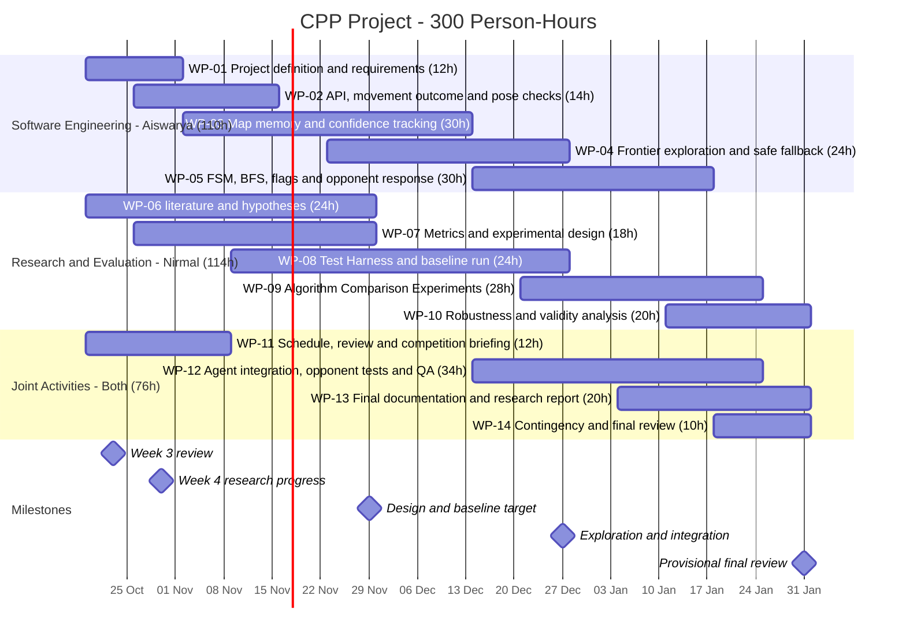

# Project Schedule

**Project:** C++ Capture The Flag Agent (Software Engineering + Research)
**Team:** Aiswarya Payakkal Vinayan and Nirmal Mohan
**Planning horizon:** 19 October 2026 – 31 January 2027

## Effort summary

| Workstream | Planned person-hours |
|---|---:|
| Software Engineering — Aiswarya | 110 |
| Research, testing and evaluation — Nirmal | 114 |
| Joint activities | 76 |
| **Total** | **300** |

For resource planning, joint work is **allocated equally** between the two students (38 hours each). As a result, **Aiswarya has 148 planned hours** and **Nirmal has 152 planned hours**. These are estimates, not recorded hours worked.

## Work packages Schedules

| WP | Work package | Responsible | Start | End | Hours |
|---|---|---|---|---|---:|
| WP-01 | Project Definition and Requirements| Aiswarya P. Vinayan | 19 Oct 2026 | 01 Nov 2026 | 12 |
| WP-02 | API, movement outcome & pose checks | Aiswarya P. Vinayan | 26 Oct 2026 | 15 Nov 2026 | 14 |
| WP-03 | Map memory & confidence tracking | Aiswarya P. Vinayan | 02 Nov 2026 | 13 Dec 2026 | 30 |
| WP-04 | Frontier exploration & safe fallback | Aiswarya P. Vinayan | 23 Nov 2026 | 27 Dec 2026 | 24 |
| WP-05 | FSM, BFS, flags & opponent response | Aiswarya P. Vinayan | 14 Dec 2026 | 17 Jan 2027 | 30 |
| WP-06 | Literature & hypotheses | Nirmal Mohan | 19 Oct 2026 | 29 Nov 2026 | 24 |
| WP-07 | Metrics & experimental design | Nirmal Mohan | 26 Oct 2026 | 29 Nov 2026 | 18 |
| WP-08 | Test Harness & baseline run | Nirmal Mohan | 09 Nov 2026 | 27 Dec 2026 | 24 |
| WP-09 | Algorithm Comparison Experiments | Nirmal Mohan | 21 Dec 2026 | 24 Jan 2027 | 28 |
| WP-10 | Robustness & validity analysis | Nirmal Mohan | 11 Jan 2027 | 31 Jan 2027 | 20 |
| WP-11 | Schedule, review & competition briefing | Both (6 h each) | 19 Oct 2026 | 08 Nov 2026 | 12 |
| WP-12 | Agent integration, opponent tests & QA | Both (17 h each) | 14 Dec 2026 | 24 Jan 2027 | 34 |
| WP-13 | Final documentation & research report | Both (10 h each) | 04 Jan 2027 | 31 Jan 2027 | 20 |
| WP-14 | Contingency & final review | Both (5 h each) | 18 Jan 2027 | 31 Jan 2027 | 10 |

## Planned work-package outputs

- **WP-01 — Project Definition and Requirements:** Review objectives, host rules and competition-specific acceptance checks.
- **WP-02 — API, movement outcome & pose checks:** Validate DLL/API, movement failure detection and limits of relative position inference.
- **WP-03 — Map memory & confidence tracking:** Prototype local/persistent memory; represent uncertainty and reset on contradictions.
- **WP-04 — Frontier exploration & safe fallback:** Implement local novelty fallback and map-valid reachable frontier selection; use BFS routes in WP-05.
- **WP-05 — FSM, BFS, flags & opponent response:** Implement FSM state transitions, known-route BFS and only rule-verified flag/opponent responses; optional A* later.
- **WP-06 — Literature & hypotheses:** Review exploration, real-time search, fair benchmarks and hypotheses; document actual reading depth.
- **WP-07 — Metrics & experimental design:** Define objective detection, reliability, movement, win-rate metrics and test controls.
- **WP-08 — Test Harness & baseline runs:** Build repeatable random/safe baselines on multiple maps; reserve unseen maps for evaluation.
- **WP-09 — Algorithm Comparison Experiments** Test safe baseline, FBE-only, FBE+BFS and FBE+BFS+FSM versions if working, on held-out maps/opponents.
- **WP-10 — Robustness & validity analysis:** Analyze win rate when observable, failures, uncertainty and between-map variation.
- **WP-11 — Schedule, review & competition briefing:** Update planning and prepare Week 4 research progress briefing; review feedback.
- **WP-12 — Agent integration, opponent tests & QA:** Integrate hybrid agent, perform host compatibility and opponent/robustness tests.
- **WP-13 — Final documentation & research report:** Reproduce source, test conditions, baseline comparisons and limitations.
- **WP-14 — Contingency & final review:** Use buffer for critical defects, unknown map failures and final review.

## Dependencies and parallel research–software activities

- **WP-01/02:** Confirm requirements, host rules, DLL/API behavior and movement outcome assumptions.
- **WP-03:** Investigate reliable relative pose/memory, with uncertainty detection and recovery.
- **WP-04:** Build local safe exploration fallback and valid frontier selection. Persistent frontier targets require a spatially consistent map and verified pose.
- **WP-05:** Add BFS over known traversable cells and an FSM for explore/approach/pickup/return/deliver/respond/recover. All state transitions must use verified observations. A* is an optional optimization.
- **WP-06/07/08:** Research, measurement design and reference baseline tests proceed in parallel; reserve held-out map layouts for generalization assessment.
- **WP-09/10:** Compare tested algorithms (safe, FBE, FBE+BFS, FBE+BFS+FSM) **only after each variant works**; compare **only implemented and tested** policies across repeated map and opponent conditions, then analyze failures, uncertainty and robustness.
- **WP-11–14:** Coordinate reviews, integration, reporting, contingency and competition readiness.

**Note:** WP-04 and WP-05 overlap with map-memory development intentionally; early local policies can be tested without claiming a reliable full map.

## Milestones

| Milestone | Target period | Deliverable |
|---|---|---|
| M1 | October 2026 | project definition, research plan and Gantt review |
| M2 | November 2026 | Design, literature review, metrics and baseline test setup |
| M3 | December 2026 | Navigation prototypes, software integration and initial controlled comparisons |
| M4 | January 2027 | Evaluation, final QA, documentation and submission window |

## Delivery and tracking

- Development process: iterative and incremental development with GitHub Issues / lightweight Kanban.
- Track each work package in GitHub, with assignees and a reviewer named in the issue body or pull request.
- Review hours, dependencies, and progress weekly. If the official university deadline differs, update this schedule accordingly.
- Record individual contribution, decisions and actual tests in `devlog/developer-diary.md`.

## Gantt Chart

## Week 6 practical activities — inside the existing work packages

The professors' additional Week 6 feedback refocuses **activity priorities, not the approved Gantt**. Keep all existing WP IDs, titles, owners, dates, person-hours and chart statuses unchanged.

| WP | Responsible | Week 6 activity / remaining acceptance |
|---|---|---|
| WP-02 | Aiswarya | Review self-developed ScoutAgent, build and load it in the original Windows host, verify movement and pickup behavior |
| WP-03 | Aiswarya | Investigate movement-observation uncertainty and a trusted-pose gate; persistent global memory remains unfinished |
| WP-06 | Nirmal | Focus reading only on three source themes directly linked to implementation and metrics; actual reading notes pending |
| WP-07 | Nirmal | Define map-coverage (simulator only), blocked requests, waits, flag-cell arrival and pickup-request metrics |
| WP-08 | Nirmal | Run six authored offline development maps, reserve one untouched holdout and reproduce results on Windows |
| WP-11 follow-up | Both | Confirm review decisions, actual individual contributions and repository commits; WP-11 remains Done in the approved Gantt |

Existing Week 5 agent comparisons are **historical API/regression checks**. Week 6 evaluation is focused on **ScoutAgent against its own defined acceptance criteria on different maps**. Future comparisons in WP-09, if performed, must concern implemented validated variants under controlled conditions; no new StupidAgent-versus-ScoutAgent result is claimed here.

**11 November status:** offline testing passed (19/19 ScoutAgent unit, 8/8 observation, six map fixtures, five native exports). Windows graphical-host tests, signed review and GitHub push remain pending/undocumented. See `research-plan.md`, `software-architecture.md` and `../devlog/developer-diary.md`.
